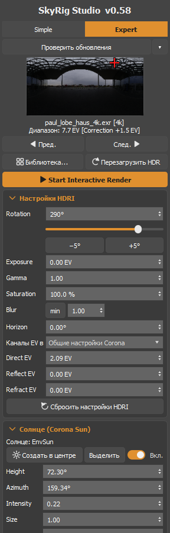
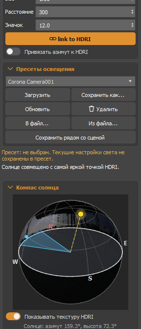
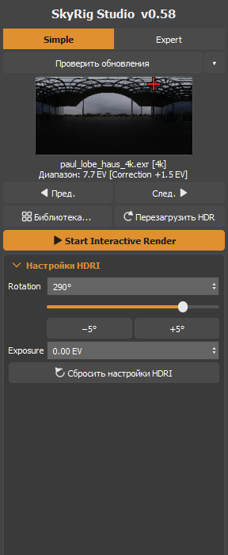
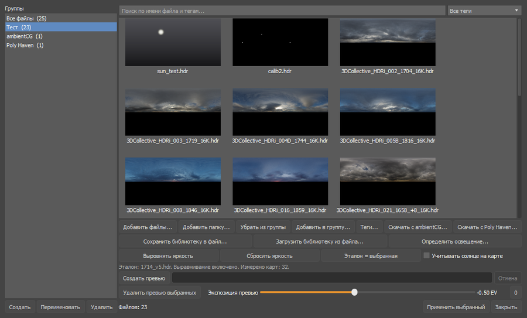
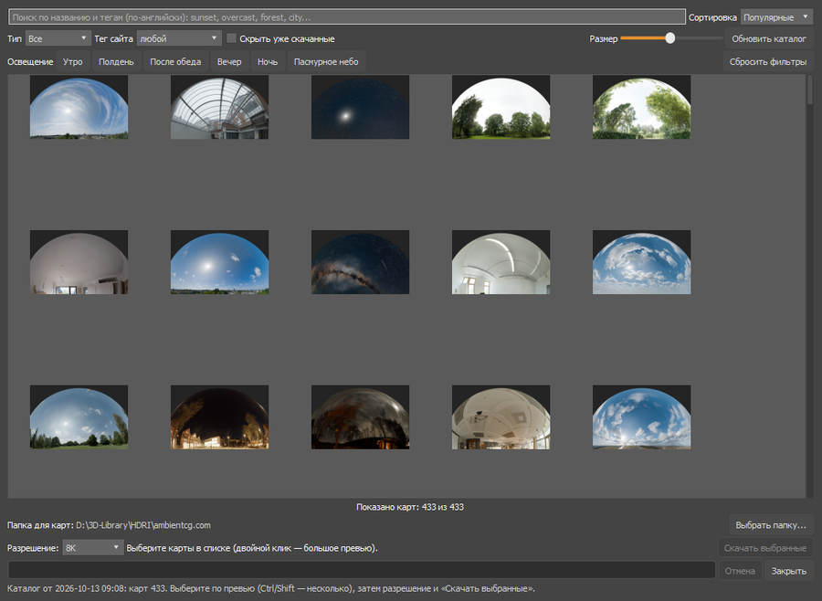
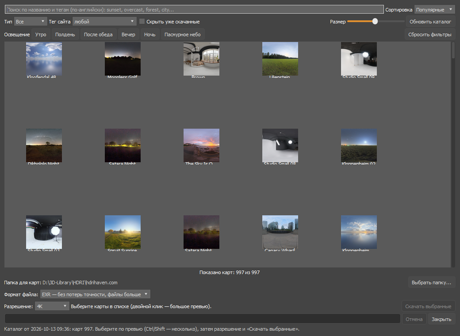

# SkyRig Studio

Окружение (HDRI + Corona Sun) для **3ds Max + Corona Renderer**: библиотека HDRI, управление картой и солнцем, пресеты
и загрузка карт из интернета в одной панели. Скрипт ничего не делает «в фоне» (без callbacks, таймеров и потоков) и не
слушает Max: каждое действие — один undo-блок.

<p align="center">
  
  
  
</p>

## Что умеет
- **Библиотека HDRI** — группы, теги, поиск, превью, подпись с разрешением (например, `[8k]`), автоопределение типа освещения.
- **Управление картой** — поворот, Exposure, Gamma, Saturation, Blur, Horizon, отдельные EV для Direct / Reflect / Refract,
  переключение карт «Пред. / След.».
- **Corona Sun, привязанное к карте** — находит самую яркую точку HDRI и ставит солнце в то же направление с учётом
  поворота; привязка азимута; компас солнца с превью карты.
- **Выравнивание яркости** — приводит карты к единому уровню освещённости по эталонной, чтобы при смене HDRI свет не «прыгал».
- **Пресеты** — освещение целиком (карта, параметры, солнце); при сохранении подставляется имя активной камеры.
- **Загрузка карт из интернета** — ambientCG и Poly Haven (лицензия CC0), выбор разрешения, проверка целостности файлов.
- **Своя история изменений** — «Отменить / Вернуть» для всех действий скрипта.
- **Режимы Simple / Expert** — только основное или все параметры.
- **Обновление одной кнопкой** — с подтверждением и откатом к предыдущей версии.

## Скриншоты
**Библиотека HDRI**



**Загрузка с ambientCG** и **Poly Haven**





## Требования
- 3ds Max **2025 или новее** (нужен PySide6; проверено на 3ds Max 2027).
- Corona Renderer (проверено на Corona 16).
- Windows. Для обновлений и загрузки карт — доступ в интернет (сам скрипт работает и без него).

## Установка
1. Скачайте [`dist/SkyRigStudio.mzp`](https://github.com/lamer486/SkyRigStudio/raw/main/dist/SkyRigStudio.mzp).
2. Перетащите файл мышью в окно 3ds Max (в любой вьюпорт). Установщик скопирует скрипт и создаст кнопку.
3. Выведите кнопку на панель: **Customize → Customize User Interface → Toolbars** (или Menus / Quads) →
   категория **SkyRig Studio** → перетащите «SkyRig Studio» на панель. Запуск — по этой кнопке.

Окно встраивается слева в интерфейс Max (его можно перетащить к правому краю или оторвать).

## Обновление
В верху окна есть кнопка **«Проверить обновления»**. Раз в сутки скрипт тихо проверяет версию сам; если вышла новая,
кнопка становится зелёной — **«Обновить до vX.Y»**. Нажмите её, прочтите список изменений и подтвердите:
файл скачивается, проверяется (контрольная сумма sha256, синтаксис, номер версии), и окно перезапускается.
Предыдущая версия сохраняется — меню **«▾» → «Вернуть предыдущую версию»**. Автопроверку можно отключить там же.

## Удаление
В Max: **Customize → Customize User Interface → Toolbars**, категория **SkyRig Studio**, кнопка **«Uninstall SkyRig Studio»**
(перетащите её на панель и нажмите) — или перетащите в окно Max `dist/SkyRigStudio_Uninstall.mzp`. Библиотека, пресеты и кэш лежат отдельно в
`%APPDATA%\SafeEnvironment` — установщик спросит, удалять ли их.

## Где что хранится
| Что | Где |
|---|---|
| Скрипт | `%LOCALAPPDATA%\Autodesk\3dsMax\<версия> - 64bit\ENU\scripts\SkyRigStudio\` |
| Библиотека, пресеты, кэш, резервные копии версий | `%APPDATA%\SafeEnvironment\` |
| Сцена 3ds Max | скрипт ничего в неё не записывает, кроме самого окружения (Corona Color Correct → CoronaBitmap) и одного Corona Sun |

Библиотека хранит **полные пути** к HDRI, поэтому на другом компьютере она начинается пустой; перенос — кнопки
«Сохранить библиотеку в файл» / «Загрузить библиотеку из файла» (сами HDRI при этом не копируются).

## Интернет и приватность
Скрипт обращается в сеть только: (1) раз в сутки к `raw.githubusercontent.com` за номером версии (можно выключить),
(2) по вашей команде — к `ambientcg.com` и `polyhaven.com` за каталогом и картами (лицензия CC0), (3) по кнопке «Обновить» —
за новым файлом скрипта. Никаких данных о вас или сцене не отправляется.

---

## Для владельца репозитория: как выпустить новую версию
Нужен Python 3 (подойдёт любой). В корне репозитория:

```
python tools/make_release.py --src skyrig_studio_v0.51.py --notes "Что нового 1" "Что нового 2"
```

Скрипт проверит файл, пропишет адрес обновлений, положит копию в `releases/`, посчитает контрольную сумму, обновит
`version.json`, `CHANGELOG.md` и пересоберёт `dist/*.mzp`. Затем загрузите изменённые файлы в репозиторий (`git add -A && git commit && git push`
или «Add file → Upload files» на сайте GitHub). Пользователи увидят обновление в течение суток (или сразу по кнопке). GitHub кэширует файлы до ~5 минут, так что сразу
после загрузки проверка может ещё показывать старую версию — это нормально.

Важно: `version.json` и файл из `releases/` должны попадать в репозиторий **вместе** — контрольная сумма в манифесте
привязана к файлу; если они разойдутся, скрипты у пользователей откажутся обновляться (это защита).

Первый выпуск (один раз, указываем логин и имя репозитория):
```
python tools/make_release.py --src skyrig_studio_v0.50.py --repo ВАШ_ЛОГИН/SkyRigStudio --notes "Первая публикация"
```

Репозиторий должен быть **публичным** (иначе `raw.githubusercontent.com` не отдаёт файлы без токена).
Адрес манифеста можно переопределить без правки скрипта: положите его в первую строку файла
`%APPDATA%\SafeEnvironment\update_url.txt` (например, для тестовой ветки или файла на сетевой папке).

## English (short)
SkyRig Studio — HDRI + Corona Sun environment tool for 3ds Max 2025+ with Corona. Install: drag
`dist/SkyRigStudio.mzp` into the 3ds Max window, then add the **SkyRig Studio** macro (category *SkyRig Studio*) to a
toolbar. Updates: button at the top of the panel (checks `version.json` on GitHub, verifies SHA-256, keeps a backup for
rollback). Uninstall: drag `dist/SkyRigStudio_Uninstall.mzp`. User data lives in `%APPDATA%\SafeEnvironment`.
